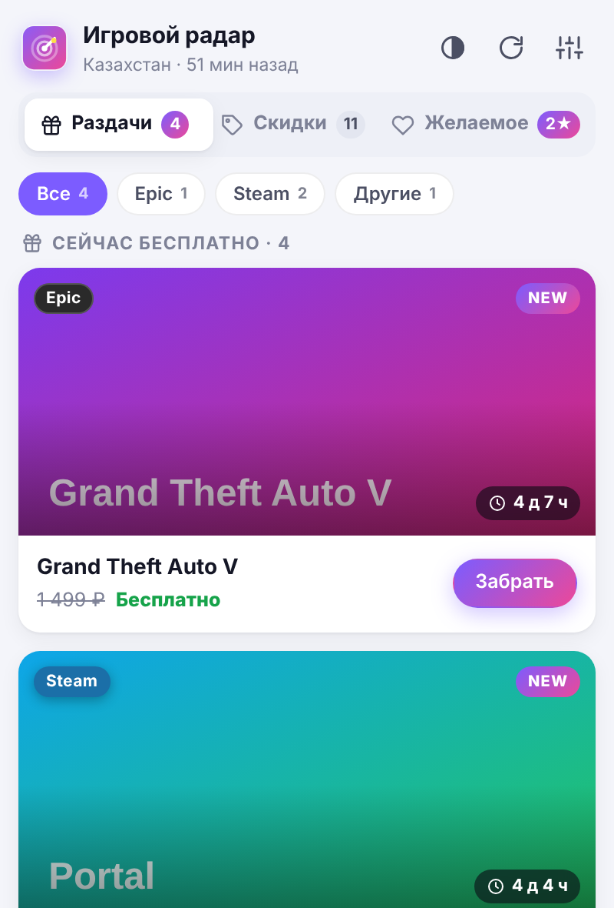

# Game-Radar-Price

🎯 **Game Radar / Игровой радар** — раздачи и скидки.

Расширение для **Firefox / Zen** и **Chromium** (Chrome, Opera GX, Edge, Яндекс Браузер): следит за
бесплатными раздачами и скидками в Steam, Epic Games, GOG и других магазинах, ведёт список желаемого и
присылает уведомления.



## Возможности

- **🎁 Раздачи**: еженедельные бесплатные игры Epic (текущие и «скоро бесплатно»), Steam free-to-keep, GOG,
  Prime Gaming, Ubisoft, itch.io (через GamerPower). Живой таймер до конца раздачи и метка NEW.
- **🔥 Скидки**: Steam, Epic и GOG. Есть поиск, фильтр по магазину и минимальной скидке, сортировка по скидке,
  цене, рейтингу и сроку окончания.
- **💜 Желаемое**: игру можно найти поиском, добавить кнопкой ♥ или с открытой вкладки Steam, Epic или GOG.
  Можно задать целевую цену в своей валюте. Уведомление придёт, когда цена до неё опустится, когда появится
  скидка или когда игру начнут раздавать бесплатно.
- **💱 Валюта**: по умолчанию выбирается по языку интерфейса (русский → ₽, English → $, Deutsch/Español → €,
  Türkçe → ₺, Polski → zł). В настройках можно выбрать любую из 24 валют. Цены из магазинов в другой валюте
  пересчитываются по текущему курсу и помечаются знаком **≈**, а при наведении видна исходная цена.
- **🌍 Страна** определяется по IP через Cloudflare раз в сутки. От страны зависят цены Steam и Epic, её же
  видно в шапке окна. Если пользуешься VPN, выбери страну вручную в настройках.
- **🗣 Языки**: русский, English, Deutsch, Español, Türkçe, Polski. По умолчанию язык берётся из браузера, его
  можно сменить в настройках.
- **🔔 Уведомления**, **🎨 светлая/тёмная тема** с плавными анимациями, экспорт и импорт списка желаемого.

## Установка

Готовые архивы появляются после сборки (`npm run build`, нужен Node.js 18+):
`dist/game-radar-firefox-<версия>.zip` и `dist/game-radar-chromium-<версия>.zip`.

### Chrome / Opera GX / Edge / Яндекс
1. Открой `chrome://extensions` (в Opera GX — `opera://extensions`, в Edge — `edge://extensions`).
2. Включи «Режим разработчика».
3. Нажми «Загрузить распакованное расширение» и выбери папку `dist/chromium`.

### Firefox / Zen
- **Временно** (до перезапуска): `about:debugging#/runtime/this-firefox` → «Загрузить временное дополнение…» →
  выбери `dist/game-radar-firefox-<версия>.zip`.
- **Постоянно**: подпиши расширение бесплатно для личного использования. Получи ключи на
  https://addons.mozilla.org/developers/addon/api/key/ и выполни:
  ```bash
  npx web-ext sign --source-dir dist/firefox --channel=unlisted --api-key=JWT_ISSUER --api-secret=JWT_SECRET
  ```

После установки откроется приветственная страница. Нажми «Разрешить доступ к магазинам».

## Источники данных
| Что | Откуда |
|---|---|
| Раздачи Epic | официальный `freeGamesPromotions` Epic Games Store |
| Раздачи всех площадок | [GamerPower API](https://www.gamerpower.com/api-read) |
| Скидки и цены Steam | Steam Store API (`featuredcategories`, `appdetails`, `storesearch`) |
| Скидки Epic и GOG, поиск | [CheapShark API](https://apidocs.cheapshark.com/) (цены в USD → пересчёт) |
| Курсы валют | [fawazahmed0/currency-api](https://github.com/fawazahmed0/exchange-api), запасной — open.er-api.com |
| Страна | Cloudflare `cdn-cgi/trace`, запасной — country.is |

API-ключи не нужны. Расширение ничего не отправляет о тебе, только читает эти API.

## Разработка
```bash
npm test         # юнит-тесты (node:test, фикстуры в tests/fixtures)
npm run build    # dist/firefox, dist/chromium и zip-архивы для обоих браузеров
npm run lint     # сборка + проверка валидатором Mozilla (web-ext lint)
```

Структура:
```
background.js         расписание (alarms), уведомления, бейдж; service worker в Chromium
lib/sources/*.js      загрузка и разбор API: epic, gamerpower, steam, cheapshark
lib/compose.js        сборка итоговых списков (дедупликация, фильтры)
lib/currency.js       валюта отображения, курсы, пересчёт цен
lib/geo.js            определение страны по IP, названия стран
lib/wishlist.js       цены и правила уведомлений для желаемого
lib/i18n/             словари интерфейса (ru, en, de, es, tr, pl) и автоопределение языка
_locales/             название и описание расширения для менеджера дополнений
popup/ options/ onboarding/   окно расширения, настройки, приветствие
scripts/build.mjs     сборка под Firefox и Chromium
```

## Лицензия
MIT
